<!--
IMPORTANT:
1. Upload assets/animated_github_banner.gif to your GitHub profile repository.
2. Keep the file path exactly as shown below, or update the image path if you rename it.
3. GitHub README files do not run CSS/JavaScript animations. Use the animated GIF for movement.
-->

  

  <h1>Hi 👋, I'm Archana Yadav</h1>
  <h3>Software Developer | Aspiring Software Engineer | Full Stack Developer</h3>
  
<em>Turning complex problems into simple solutions.</em>

  

---

## 👩‍💻 About Me

<table>
  <tr>
    <td width="60%" valign="middle">

### ⚡ Turning ideas into scalable software

I'm a **Software Developer** who loves transforming complex problems into clean, reliable and user-friendly applications. From **Spring Boot** backends to **React** interfaces, I build full-stack solutions focused on performance and real-world impact.

- 🔭 **Building:** Real-world apps & AI-powered solutions
- 🌱 **Learning:** Advanced Java · Spring Boot · DSA · System Design
- 💬 **Ask me about:** Java · React.js · Full-Stack Development
- 📫 **Reach me:** [archanayadav2737@gmail.com](mailto:archanayadav2737@gmail.com)

    </td>
    <td width="40%" align="center" valign="middle">
      
    </td>
  </tr>
</table>

---

## 🛠️ Skills

<table>
  <tr>
    <td><b>Languages</b></td>
    <td>
      
      
      
      
    </td>
  </tr>
  <tr>
    <td><b>Frontend</b></td>
    <td>
      
      
      
      
      
      
    </td>
  </tr>
  <tr>
    <td><b>Backend</b></td>
    <td>
      
      
      
      
    </td>
  </tr>
  <tr>
    <td><b>Databases</b></td>
    <td>
      
      
      
    </td>
  </tr>
  <tr>
    <td><b>Cloud & Tools</b></td>
    <td>
      
      
      
      
      
    </td>
  </tr>
  <tr>
    <td><b>Design & Charts</b></td>
    <td>
      
      
      
      
    </td>
  </tr>
</table>

---

## 🤝 Connect with Me

---

  <em>“Keep learning, keep building, and make technology useful.”</em>

